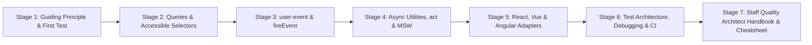
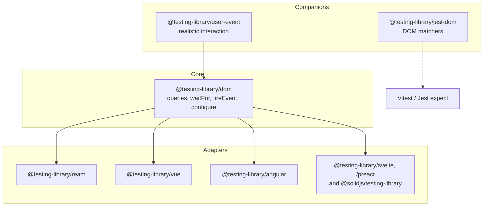
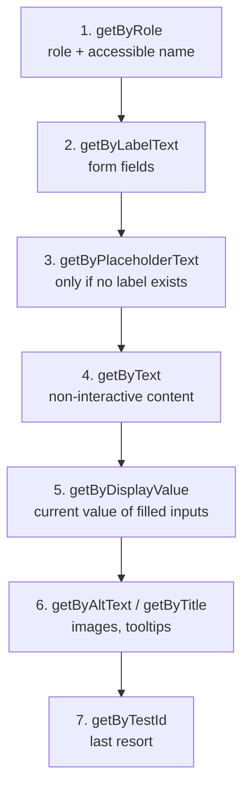
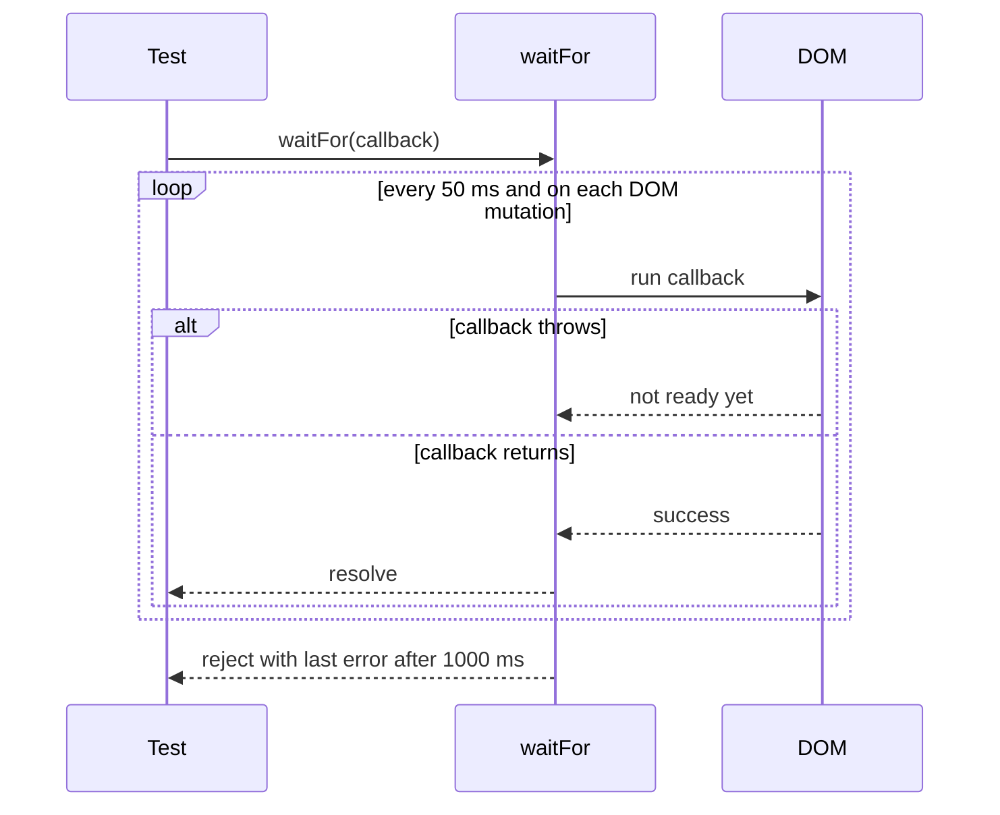
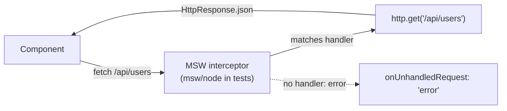
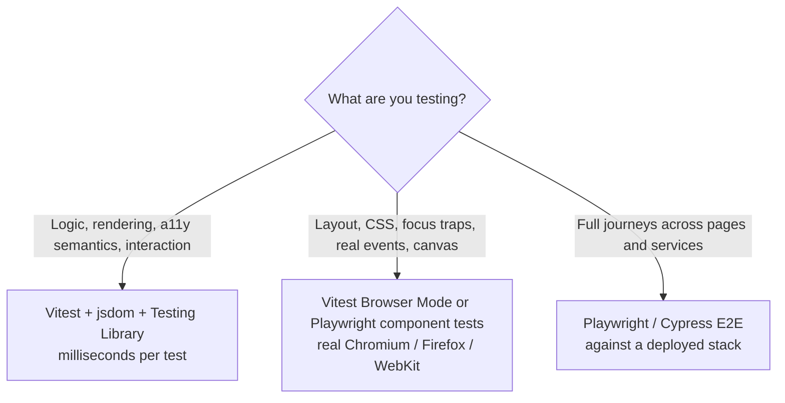

# Learn Testing Library 🐙

<div align="center">

[](https://opensource.org/licenses/MIT)
[](https://testing-library.com/)
[](https://react.dev/)
[](https://vitest.dev/)
[](https://github.com/testing-library/user-event)
[](https://github.com/TheLearningHubOrg/learn-testing-library)

**An exhaustive, production-grade masterclass from absolute zero to staff-level Testing Library architecture.**  
Master user-centric queries, `user-event`, async utilities, accessible selectors, network mocking with MSW, and testing React, Vue and Angular components the way real people use them.

[Getting Started](#1-stage-1-absolute-beginner-foundations--the-guiding-principle) • [Queries & Selectors](#2-stage-2-queries-deep-dive--accessible-selectors) • [Simulating Users](#3-stage-3-simulating-users-user-event--fireevent) • [Async & Mocking](#4-stage-4-async-utilities-act--network-mocking) • [Framework Adapters](#5-stage-5-framework-adapters-react-vue--angular) • [Production Architecture](#6-stage-6-production-test-architecture-debugging--ci) • [Staff Handbook](#7-stage-7-staff-frontend-quality-architect-interview-handbook--cheatsheet)

<br/>

<a href="https://www.buymeacoffee.com/manthanank">
  
</a>

</div>

---

## 🗺️ 7-Stage Pedagogical Roadmap



| Stage | Domain Focus | Core Concepts & Production Outcomes |
| :--- | :--- | :--- |
| **Stage 1** | **Guiding Principle & Toolchain** | Behaviour over implementation details, the package family (`@testing-library/dom`, `/react`, `/vue`, `/angular`, `/user-event`, `/jest-dom`), Vitest + jsdom setup, `render` and `screen`. |
| **Stage 2** | **Queries & Accessible Selectors** | `getBy` / `queryBy` / `findBy` semantics, query priority, `ByRole` with `name`, `level`, `checked`, `expanded`, `TextMatch`, `within`, jest-dom matchers. |
| **Stage 3** | **Simulating Real Users** | `userEvent.setup()`, pointer and keyboard sessions, `type`, `clear`, `tab`, `selectOptions`, `upload`, clipboard, and when `fireEvent` is still the right tool. |
| **Stage 4** | **Async Utilities & Network Mocking** | `findBy`, `waitFor`, `waitForElementToBeRemoved`, `act()` warnings explained, fake timers with `advanceTimers`, MSW `http` handlers and `setupServer`. |
| **Stage 5** | **Framework Adapters** | React `render` options, `wrapper`, `rerender`, `renderHook`; Vue `props`/`slots`/`global.plugins`; Angular `inputs`, `providers` and standalone components. |
| **Stage 6** | **Production Test Architecture** | Custom `render` with providers, `screen.debug`, `logRoles`, `configure`, `eslint-plugin-testing-library`, coverage gates, Docker CI, browser mode and E2E boundaries. |
| **Stage 7** | **Staff Quality Architect Handbook** | 40 staff-level scenario Q&As, flake root causes, enterprise cheatsheet, and the trade-offs behind each recommendation. |

---

## 📋 Table of Contents
- [1. Stage 1: Absolute Beginner Foundations & The Guiding Principle](#1-stage-1-absolute-beginner-foundations--the-guiding-principle)
  - [1.1 Why Testing Library Exists](#11-why-testing-library-exists)
  - [1.2 The Package Family & How They Fit Together](#12-the-package-family--how-they-fit-together)
  - [1.3 Installing Vitest, jsdom & React Testing Library](#13-installing-vitest-jsdom--react-testing-library)
  - [1.4 Your First Test: render, screen & expect](#14-your-first-test-render-screen--expect)
- [2. Stage 2: Queries Deep Dive & Accessible Selectors](#2-stage-2-queries-deep-dive--accessible-selectors)
  - [2.1 Query Variants: getBy, queryBy, findBy & the All Forms](#21-query-variants-getby-queryby-findby--the-all-forms)
  - [2.2 Query Priority: Choosing the Right Selector](#22-query-priority-choosing-the-right-selector)
  - [2.3 ByRole & the Accessibility Tree](#23-byrole--the-accessibility-tree)
  - [2.4 TextMatch, Normalizers & Scoping with within](#24-textmatch-normalizers--scoping-with-within)
  - [2.5 jest-dom Matchers for Readable Assertions](#25-jest-dom-matchers-for-readable-assertions)
- [3. Stage 3: Simulating Users: user-event & fireEvent](#3-stage-3-simulating-users-user-event--fireevent)
  - [3.1 Why user-event Beats fireEvent](#31-why-user-event-beats-fireevent)
  - [3.2 The setup() Session API](#32-the-setup-session-api)
  - [3.3 Keyboard, Pointer, Clipboard & File Upload](#33-keyboard-pointer-clipboard--file-upload)
  - [3.4 Testing a Form End to End](#34-testing-a-form-end-to-end)
- [4. Stage 4: Async Utilities, act & Network Mocking](#4-stage-4-async-utilities-act--network-mocking)
  - [4.1 findBy, waitFor & waitForElementToBeRemoved](#41-findby-waitfor--waitforelementtoberemoved)
  - [4.2 Understanding act() and Its Warnings](#42-understanding-act-and-its-warnings)
  - [4.3 Fake Timers with user-event](#43-fake-timers-with-user-event)
  - [4.4 Mocking HTTP with Mock Service Worker](#44-mocking-http-with-mock-service-worker)
- [5. Stage 5: Framework Adapters: React, Vue & Angular](#5-stage-5-framework-adapters-react-vue--angular)
  - [5.1 React Testing Library in Depth](#51-react-testing-library-in-depth)
  - [5.2 Vue Testing Library](#52-vue-testing-library)
  - [5.3 Angular Testing Library](#53-angular-testing-library)
  - [5.4 One Behaviour, Three Frameworks](#54-one-behaviour-three-frameworks)
- [6. Stage 6: Production Test Architecture, Debugging & CI](#6-stage-6-production-test-architecture-debugging--ci)
  - [6.1 Custom render & Shared Test Utilities](#61-custom-render--shared-test-utilities)
  - [6.2 Debugging Failing Queries](#62-debugging-failing-queries)
  - [6.3 Linting Tests with eslint-plugin-testing-library](#63-linting-tests-with-eslint-plugin-testing-library)
  - [6.4 Coverage, CI & Docker](#64-coverage-ci--docker)
  - [6.5 Where Testing Library Stops: Browser Mode & E2E](#65-where-testing-library-stops-browser-mode--e2e)
- [7. Stage 7: Staff Frontend Quality Architect Interview Handbook & Cheatsheet](#7-stage-7-staff-frontend-quality-architect-interview-handbook--cheatsheet)
  - [7.1 Enterprise Production Cheatsheet](#71-enterprise-production-cheatsheet)
  - [7.2 Staff & Principal Architect Interview Q&A (40 Scenarios)](#72-staff--principal-architect-interview-qa-40-scenarios)
- [🤝 Contributing](#-contributing)
- [📄 License](#-license)

---

## 1. Stage 1: Absolute Beginner Foundations & The Guiding Principle

### 1.1 Why Testing Library Exists

Most UI test suites fail for the wrong reasons. A developer renames a CSS class, splits a component in two, or swaps a `useState` for a reducer, and dozens of tests go red even though nothing a user can see has changed. The opposite also happens: a button loses its label, a form stops submitting on Enter, and every test stays green because the tests only poked at component internals.

Testing Library is built around one idea: **the more a test resembles the way the software is used, the more confidence it gives you.** Users do not know about props, state or component instances. They find things by what they read on screen and what assistive technology announces, then they click, type and wait. So the library gives you:

1. **Queries that mirror human perception:** find an element by its role and accessible name, its label, or its visible text, not by class names or component tree position.
2. **Interaction helpers that mirror real input:** `user-event` dispatches the full sequence of events a browser fires for a click or a keystroke.
3. **Async helpers that mirror waiting:** `findBy` and `waitFor` retry until the UI reaches the expected state, the same way a person waits for a spinner to go away.
4. **No access to internals:** there is no `instance()`, no `state()`, no shallow rendering. If you need those to write a test, the test is probably coupled to implementation details.

```
 Implementation-detail test                 Testing Library test
 ──────────────────────────                 ────────────────────
 wrapper.find('.btn-primary')               screen.getByRole('button', { name: 'Save' })
 wrapper.setState({ open: true })           await user.click(toggle)
 expect(wrapper.state('items')).toHaveLength(3)
                                            expect(screen.getAllByRole('listitem')).toHaveLength(3)

 Breaks on: class rename, refactor          Breaks on: label removed, role wrong,
 Passes when: label is missing              behaviour actually broken
```

A useful side effect is that tests written this way double as a lightweight accessibility check. If `getByRole('button', { name: 'Save' })` cannot find your button, a screen reader user probably cannot either.

### 1.2 The Package Family & How They Fit Together

Testing Library is a set of small packages layered on a shared core.



| Package | Responsibility |
| :--- | :--- |
| `@testing-library/dom` | Framework-agnostic queries, `waitFor`, `fireEvent`, `within`, `prettyDOM`, `configure`. Every adapter re-exports it. |
| `@testing-library/react` | `render`, `renderHook`, `cleanup`, `act` integration. Since v16, `@testing-library/dom` is a peer dependency you install yourself. |
| `@testing-library/vue` | `render` for Vue 3 single-file components, with `props`, `slots` and `global` mounting options. |
| `@testing-library/angular` | `render` that builds a `TestBed` for a component, with `inputs`, `providers` and `imports`. |
| `@testing-library/user-event` | Simulates full interactions (pointer, keyboard, clipboard) on top of the DOM. |
| `@testing-library/jest-dom` | Custom matchers such as `toBeInTheDocument`, `toBeDisabled`, `toHaveAccessibleName`. Works with Jest and Vitest. |

The runner (Vitest or Jest) provides `describe`, `it`, `expect` and mocking. The DOM itself comes from `jsdom` or `happy-dom`, which are JavaScript implementations of browser APIs that run in Node.

### 1.3 Installing Vitest, jsdom & React Testing Library

The companion project in this repository uses Vite, Vitest and React 19. Here is the minimal setup from scratch.

```bash
# 1. Runtime dependencies
npm install react react-dom

# 2. Test toolchain
npm install -D vitest jsdom @vitejs/plugin-react vite typescript

# 3. Testing Library packages (dom is a peer dependency of the React adapter)
npm install -D @testing-library/react @testing-library/dom \
  @testing-library/user-event @testing-library/jest-dom

# 4. Types
npm install -D @types/react @types/react-dom
```

```typescript
// vite.config.ts
/// <reference types="vitest/config" />
import { defineConfig } from 'vite';
import react from '@vitejs/plugin-react';

export default defineConfig({
  plugins: [react()],
  test: {
    // 1. Give every test file a browser-like document
    environment: 'jsdom',
    // 2. Expose describe/it/expect globally (also enables RTL auto-cleanup)
    globals: true,
    // 3. Register jest-dom matchers once for the whole suite
    setupFiles: ['./tests/setup.ts'],
    include: ['tests/**/*.test.tsx'],
    // 4. Reset vi.spyOn / vi.fn implementations between tests
    restoreMocks: true,
  },
});
```

```typescript
// tests/setup.ts
import '@testing-library/jest-dom/vitest';
import { cleanup } from '@testing-library/react';
import { afterEach } from 'vitest';

afterEach(() => {
  cleanup(); // unmount everything rendered in the previous test
});
```

Add `"types": ["vitest/globals", "@testing-library/jest-dom/vitest"]` to `tsconfig.json` so the editor knows about the global test functions and the extra matchers.

> **Jest users:** the same packages work. Install `jest`, `jest-environment-jsdom` and a transformer (`babel-jest` or `ts-jest`), set `testEnvironment: 'jsdom'`, and import `@testing-library/jest-dom` in a file listed under `setupFilesAfterEnv`, which runs once the test framework is installed in the environment.

### 1.4 Your First Test: render, screen & expect

Take a disclosure widget: a button that shows and hides a panel.

```typescript
// src/components/Disclosure.tsx
import { useId, useState, type ReactNode } from 'react';

export function Disclosure({ summary, children }: { summary: string; children: ReactNode }) {
  const [open, setOpen] = useState(false);
  const panelId = useId();

  return (
    <div>
      <button type="button" aria-expanded={open} aria-controls={panelId} onClick={() => setOpen((v) => !v)}>
        {summary}
      </button>
      <div id={panelId} role="region" aria-label={summary} hidden={!open}>
        {children}
      </div>
    </div>
  );
}
```

```typescript
// tests/disclosure.test.tsx
import { render, screen } from '@testing-library/react';
import userEvent from '@testing-library/user-event';
import { Disclosure } from '../src/components/Disclosure';

test('reveals the panel when the button is pressed', async () => {
  // 1. Arrange: render into a fresh container attached to document.body
  const user = userEvent.setup();
  render(
    <Disclosure summary="Shipping details">
      <p>Ships in two days</p>
    </Disclosure>,
  );

  // 2. Find the control the way a screen reader user would
  const button = screen.getByRole('button', { name: 'Shipping details' });
  expect(button).toHaveAttribute('aria-expanded', 'false');

  // 3. Act like a user
  await user.click(button);

  // 4. Assert on what the user can now perceive
  expect(button).toHaveAttribute('aria-expanded', 'true');
  expect(screen.getByRole('region', { name: 'Shipping details' })).toHaveTextContent('Ships in two days');
});
```

Three things to notice:

1. **`screen`** is bound to `document.body`. Using it instead of destructuring queries from `render()` means you never have to update the destructuring when you add a query, and the test reads top to bottom.
2. **`hidden` elements are invisible to role queries.** Before the click, `queryByRole('region')` returns `null` because the `hidden` attribute removes the panel from the accessibility tree. That mirrors what assistive technology sees.
3. **Every `user` call is awaited.** `user-event` v14 is fully asynchronous.

Run it:

```bash
npx vitest run          # single pass, CI style
npx vitest              # watch mode with instant re-runs
npx vitest run -t "reveals the panel"   # filter by test name
```

---

## 2. Stage 2: Queries Deep Dive & Accessible Selectors

### 2.1 Query Variants: getBy, queryBy, findBy & the All Forms

Every query comes in six forms. The suffix (`ByRole`, `ByLabelText`, ...) decides *how* to match; the prefix decides *what happens when the match count is wrong*.

| Prefix | 0 matches | 1 match | 2+ matches | Async | Use it for |
| :--- | :--- | :--- | :--- | :--- | :--- |
| `getBy` | throws | returns element | throws | no | Elements that must be present right now |
| `queryBy` | returns `null` | returns element | throws | no | Asserting something is **absent** |
| `findBy` | rejects after timeout | resolves element | rejects | yes | Elements that will appear after async work |
| `getAllBy` | throws | array | array | no | Lists that must have at least one item |
| `queryAllBy` | `[]` | array | array | no | Counting items that may be zero |
| `findAllBy` | rejects after timeout | array | array | yes | Lists that load asynchronously |

```typescript
// Present now
const heading = screen.getByRole('heading', { name: 'Team members' });

// Must NOT be present: getBy would throw before the assertion runs
expect(screen.queryByRole('alert')).not.toBeInTheDocument();

// Will appear after a fetch resolves (default timeout 1000 ms)
const firstRow = await screen.findByRole('row', { name: /ada lovelace/i });

// Lists
expect(screen.getAllByRole('listitem')).toHaveLength(3);
expect(screen.queryAllByRole('listitem')).toHaveLength(0);
```

The error messages are a feature. When `getByRole` fails it prints the accessible roles currently on the page and a formatted DOM snapshot, which is usually enough to see why the match failed.

### 2.2 Query Priority: Choosing the Right Selector

Testing Library recommends queries in this order. Higher entries reflect how all users experience the page; lower entries are escape hatches.



1. **`ByRole`** covers nearly everything interactive: buttons, links, checkboxes, textboxes, headings, dialogs, tabs. The `name` option matches the accessible name, which is computed from the label, `aria-label`, `aria-labelledby` or content.
2. **`ByLabelText`** finds form controls through their `<label>`, `aria-labelledby` or `aria-label`. If a field is only findable by placeholder, it has an accessibility bug.
3. **`ByPlaceholderText`** exists, but a placeholder is not a label: it disappears as soon as someone types.
4. **`ByText`** suits paragraphs, list items and other static content.
5. **`ByDisplayValue`** finds an `input`, `select` or `textarea` by its current value, handy for pre-filled edit forms.
6. **`ByAltText`** and **`ByTitle`** match the `alt` and `title` attributes.
7. **`ByTestId`** matches `data-testid`. Use it for elements with no semantic hook, like a canvas chart wrapper, or when text is dynamic and translated.

A rough rule: if more than about 5% of your queries are `ByTestId`, the markup is probably missing labels and roles that real users also need.

### 2.3 ByRole & the Accessibility Tree

`ByRole` matches both explicit roles (`role="tab"`) and implicit roles that HTML elements carry by default.

| Element | Implicit role |
| :--- | :--- |
| `<button>`, `<input type="submit">` | `button` |
| `<a href="...">` | `link` (no `href` means no role) |
| `<input type="text">`, `<textarea>` | `textbox` |
| `<input type="search">` | `searchbox` |
| `<input type="checkbox">` | `checkbox` |
| `<input type="radio">` | `radio` |
| `<select>` | `combobox` (single) or `listbox` (multiple or with `size > 1`) |
| `<h1>` to `<h6>` | `heading` with `level` 1 to 6 |
| `<ul>`, `<ol>` / `<li>` | `list` / `listitem` |
| `<table>`, `<tr>`, `<td>`, `<th>` | `table`, `row`, `cell`, `columnheader` / `rowheader` |
| `<nav>`, `<main>` | `navigation`, `main` |
| `<form>` | `form` only when it has an accessible name |
| `<section>` | `region` only when it has an accessible name |
| `<dialog>` | `dialog` |
| `` | `img` (`alt=""` makes it `presentation`) |

The options let you assert state the way assistive technology reports it:

```typescript
// Accessible name, exact string or regex
screen.getByRole('button', { name: 'Delete invoice' });
screen.getByRole('link', { name: /privacy policy/i });

// Headings by level
screen.getByRole('heading', { level: 1 });

// Widget state
screen.getByRole('checkbox', { name: 'Remember me', checked: true });
screen.getByRole('button', { name: 'Bold', pressed: true });
screen.getByRole('button', { name: 'Filters', expanded: false });
screen.getByRole('tab', { name: 'Billing', selected: true });
screen.getByRole('link', { name: 'Dashboard', current: 'page' });

// Accessible description (aria-describedby)
screen.getByRole('textbox', { description: /at least 8 characters/i });

// Include elements removed from the accessibility tree (display:none, hidden, aria-hidden)
screen.getAllByRole('listitem', { hidden: true });
```

How the accessible name is computed matters when a query unexpectedly fails:

```
<button aria-label="Close dialog"><svg>...</svg></button>   name = "Close dialog"
<button><span aria-hidden="true">×</span> Close</button>   name = "Close"
<label for="e">Email</label><input id="e">                  name = "Email"
<input aria-labelledby="h1 h2">                             name = text of #h1 + " " + text of #h2
<input placeholder="Search">                                name = "Search" (fallback, but avoid)
```

`ByRole` walks the DOM and computes styles to decide what is inaccessible, so it is the slowest query. On very large trees, scope it with `within(container)` rather than replacing it with test IDs.

### 2.4 TextMatch, Normalizers & Scoping with within

Every text-based query accepts a `TextMatch`: a string, a regular expression or a function.

```typescript
// 1. String: exact, full-content match after whitespace normalisation
screen.getByText('Ships in two days');

// 2. Substring, case-insensitive
screen.getByText('two days', { exact: false });

// 3. Regex gives precise control
screen.getByText(/^order #\d+ confirmed$/i);

// 4. Function: (content, element) => boolean, for text split across nodes
screen.getByText((_content, element) =>
  element?.tagName === 'P' && element.textContent === 'Total: $42.00',
);

// 5. Custom normaliser: strip zero-width spaces a CMS inserts
import { getDefaultNormalizer } from '@testing-library/react';
screen.getByText('Welcome back', {
  normalizer: (text) => getDefaultNormalizer({ trim: true })(text.replace(/​/g, '')),
});
```

The default normaliser trims and collapses runs of whitespace into a single space, so indentation in JSX does not break matches.

`within` scopes queries to a subtree. It is how you assert "the Delete button in the row for Ada" without relying on DOM order.

```typescript
import { screen, within } from '@testing-library/react';

const row = screen.getByRole('row', { name: /ada lovelace/i });
await user.click(within(row).getByRole('button', { name: 'Delete' }));

const dialog = await screen.findByRole('dialog', { name: 'Confirm deletion' });
await user.click(within(dialog).getByRole('button', { name: 'Delete' }));
```

### 2.5 jest-dom Matchers for Readable Assertions

`@testing-library/jest-dom` adds matchers that read like requirements and give clear failure messages.

| Matcher | Asserts |
| :--- | :--- |
| `toBeInTheDocument()` | Element is attached to the document |
| `toBeVisible()` | Not hidden by `display`, `visibility`, `opacity: 0`, `hidden` or a hidden ancestor |
| `toBeDisabled()` / `toBeEnabled()` | Disabled state, including inherited from `<fieldset disabled>` |
| `toBeRequired()`, `toBeInvalid()`, `toBeValid()` | Form validity and `aria-invalid` |
| `toBeChecked()`, `toBePartiallyChecked()` | Checkbox, radio and `aria-checked` state |
| `toHaveFocus()` | `document.activeElement` is this element |
| `toHaveTextContent(text \| regex)` | Text content contains a match |
| `toHaveValue(v)`, `toHaveDisplayValue(v)` | Form control value |
| `toHaveFormValues({...})` | Values of every named field in a form |
| `toHaveAttribute(name, value?)` | Attribute presence and value |
| `toHaveClass(...)`, `toHaveStyle({...})` | Classes and computed style (use sparingly) |
| `toHaveAccessibleName(n)`, `toHaveAccessibleDescription(d)` | Computed accessible name and description |
| `toHaveAccessibleErrorMessage(m)` | Message linked by `aria-errormessage` |
| `toBeEmptyDOMElement()` | No child nodes besides comments |

```typescript
const email = screen.getByLabelText('Email');
expect(email).toBeInvalid();
expect(email).toHaveAccessibleDescription('Enter a valid email address');
expect(screen.getByRole('form', { name: 'Sign in' })).toHaveFormValues({ email: 'ada@example.com' });
```

> `toHaveFormValues` reads controls by their `name` attribute, so it only sees fields that have one.

---

## 3. Stage 3: Simulating Users: user-event & fireEvent

### 3.1 Why user-event Beats fireEvent

`fireEvent` dispatches exactly one DOM event. A real click is not one event.

```
 fireEvent.click(button)              user.click(button)
 ───────────────────────              ──────────────────
 click                                pointerover → pointerenter → mouseover → mouseenter
                                      pointermove → mousemove
                                      pointerdown → mousedown → focus (moves focus)
                                      pointerup → mouseup → click
```

`user-event` also enforces browser rules:

1. **Disabled elements ignore input.** Clicking a disabled button does nothing, as in a browser. `fireEvent.click` dispatches the event regardless, so whether a handler runs depends on the framework rather than on browser rules.
2. **`pointer-events: none` blocks clicks.** It checks computed styles and throws, which catches overlays that cover a button.
3. **Typing respects focus, selection and `maxLength`.** `user.type` clicks the field, then types one character at a time, firing `keydown`, `keypress`, `beforeinput`, `input` and `keyup` for each.
4. **Tab order follows the DOM and `tabindex`.** `user.tab()` moves focus the way the Tab key does.

Reach for `fireEvent` only when no user gesture produces the event: a `scroll` on a virtualised list, a `transitionend`, a custom element event, or a `resize`.

### 3.2 The setup() Session API

Since v14, call `userEvent.setup()` once per test, before rendering, and use the returned instance. The session shares keyboard and pointer state across calls, so held modifier keys and pointer position carry over just as they would for a person.

```typescript
import type { ReactElement } from 'react';
import { render, screen } from '@testing-library/react';
import userEvent from '@testing-library/user-event';

// 1. A setup helper keeps every test consistent
function setup(ui: ReactElement, options?: Parameters<typeof userEvent.setup>[0]) {
  return { user: userEvent.setup(options), ...render(ui) };
}

test('selects a plan and confirms', async () => {
  const { user } = setup(<PlanPicker />);

  // 2. Pointer
  await user.click(screen.getByRole('radio', { name: 'Pro' }));
  await user.dblClick(screen.getByText('Plan details'));
  await user.hover(screen.getByRole('button', { name: 'Help' }));

  // 3. Select boxes accept values, labels or option elements
  await user.selectOptions(screen.getByRole('combobox', { name: 'Billing cycle' }), 'Yearly');

  // 4. Text
  await user.type(screen.getByRole('textbox', { name: 'Coupon' }), 'SPRING26');
  await user.clear(screen.getByRole('textbox', { name: 'Coupon' }));

  await user.click(screen.getByRole('button', { name: 'Confirm' }));
  expect(await screen.findByRole('status')).toHaveTextContent('Pro plan active');
});
```

Useful `setup()` options:

| Option | Default | Purpose |
| :--- | :--- | :--- |
| `delay` | `0` | Milliseconds between actions. `null` skips the `setTimeout` entirely. |
| `advanceTimers` | `undefined` | Function to advance fake timers, e.g. `vi.advanceTimersByTime`. |
| `pointerEventsCheck` | `PointerEventsCheckLevel.EachApiCall` | How often to verify `pointer-events`. Lower it for speed in huge trees. |
| `skipHover` | `false` | Skip the hover events that precede a click. |
| `applyAccept` | `true` | Have `upload` respect the input's `accept` attribute. |
| `writeToClipboard` | `true` with `setup()` (`false` for the direct API) | Write copied or cut data into the stubbed `navigator.clipboard`. |

The top-level shortcuts (`userEvent.click(el)`) still exist and call `setup()` internally each time, which loses state between calls. Prefer the session.

### 3.3 Keyboard, Pointer, Clipboard & File Upload

`user.keyboard` takes a compact descriptor language.

```typescript
// Plain characters
await user.keyboard('hello');

// Named keys in braces (KeyboardEvent.key)
await user.keyboard('{Enter}');
await user.keyboard('{ArrowDown}{ArrowDown}{Enter}');

// Physical keys in brackets (KeyboardEvent.code)
await user.keyboard('[ShiftLeft]');

// Hold and release: ">" keeps it pressed, "/" releases it
await user.keyboard('{Shift>}{ArrowRight}{ArrowRight}{/Shift}'); // extend selection by 2
await user.keyboard('{Control>}a{/Control}');                    // select all

```

Focus management and keyboard-only flows are first-class:

```typescript
test('menu is fully operable with the keyboard', async () => {
  const user = userEvent.setup();
  render(<ActionsMenu />);

  await user.tab();
  expect(screen.getByRole('button', { name: 'Actions' })).toHaveFocus();

  await user.keyboard('{Enter}');
  const menu = screen.getByRole('menu', { name: 'Actions' });
  expect(within(menu).getByRole('menuitem', { name: 'Rename' })).toHaveFocus();

  await user.keyboard('{ArrowDown}');
  expect(within(menu).getByRole('menuitem', { name: 'Duplicate' })).toHaveFocus();

  await user.keyboard('{Escape}');
  expect(screen.queryByRole('menu')).not.toBeInTheDocument();
  expect(screen.getByRole('button', { name: 'Actions' })).toHaveFocus(); // focus returns
});
```

Clipboard and file inputs:

```typescript
test('pastes a tracking number and uploads a receipt', async () => {
  const user = userEvent.setup();
  render(<ReturnForm />);

  // Clipboard: user-event stubs navigator.clipboard for the session
  await user.click(screen.getByLabelText('Tracking number'));
  await user.paste('1Z999AA10123456784');
  expect(screen.getByLabelText('Tracking number')).toHaveValue('1Z999AA10123456784');

  // Upload: File objects built in memory
  const receipt = new File(['%PDF-1.7'], 'receipt.pdf', { type: 'application/pdf' });
  const input = screen.getByLabelText('Receipt');
  await user.upload(input, receipt);

  expect((input as HTMLInputElement).files?.[0]).toBe(receipt);
  expect(screen.getByText('receipt.pdf')).toBeInTheDocument();
});
```

For drag gestures and precise pointer sequences, `user.pointer` accepts an array of actions such as `[{ keys: '[MouseLeft>]', target: handle }, { coords: { x: 200 } }, { keys: '[/MouseLeft]' }]`. Keep in mind that jsdom performs no layout, so coordinate-based logic needs a real browser (see 6.5).

### 3.4 Testing a Form End to End

The companion project's `LoginForm` validates input, shows an announced error, disables the button while submitting and recovers on failure. The test covers each user-visible behaviour without touching state.

```typescript
// tests/components.test.tsx (excerpt)
import { render, screen } from '@testing-library/react';
import userEvent from '@testing-library/user-event';
import { LoginForm } from '../src/components/LoginForm';

describe('LoginForm', () => {
  it('announces a validation error and wires it to the field', async () => {
    const onSubmit = vi.fn();
    const user = userEvent.setup();
    render(<LoginForm onSubmit={onSubmit} />);

    await user.type(screen.getByLabelText('Email'), 'not-an-email');
    await user.click(screen.getByRole('button', { name: 'Sign in' }));

    expect(screen.getByRole('alert')).toHaveTextContent('Enter a valid email address');
    expect(screen.getByLabelText('Email')).toHaveAttribute('aria-invalid', 'true');
    expect(screen.getByLabelText('Email')).toHaveAccessibleDescription('Enter a valid email address');
    expect(onSubmit).not.toHaveBeenCalled();
  });

  it('disables the button while pending and reports failure', async () => {
    let reject!: (reason: Error) => void;
    const onSubmit = vi.fn(() => new Promise<void>((_, r) => (reject = r)));
    const user = userEvent.setup();
    render(<LoginForm onSubmit={onSubmit} />);

    await user.type(screen.getByLabelText('Email'), 'ada@example.com');
    await user.type(screen.getByLabelText('Password'), 'correct-horse');
    await user.click(screen.getByRole('button', { name: 'Sign in' }));

    // The promise is still pending: the UI should show progress
    expect(screen.getByRole('button', { name: /signing in/i })).toBeDisabled();

    reject(new Error('401'));

    // findBy waits for React to process the rejection
    expect(await screen.findByRole('alert')).toHaveTextContent('Sign in failed');
    expect(screen.getByRole('button', { name: 'Sign in' })).toBeEnabled();
  });

  it('can be completed with the keyboard alone', async () => {
    const onSubmit = vi.fn();
    const user = userEvent.setup();
    render(<LoginForm onSubmit={onSubmit} />);

    await user.tab();
    await user.keyboard('ada@example.com');
    await user.tab();
    await user.keyboard('correct-horse{Enter}');

    expect(onSubmit).toHaveBeenCalledOnce();
  });
});
```

The deferred promise pattern (`let reject!: ...`) is the cleanest way to hold the UI in its pending state and assert on it, then release it on your schedule.

---

## 4. Stage 4: Async Utilities, act & Network Mocking

### 4.1 findBy, waitFor & waitForElementToBeRemoved

Most UIs update asynchronously: data arrives, a debounce fires, a transition finishes. Testing Library's async utilities poll until a condition holds or a timeout expires.



| Utility | Resolves when | Defaults |
| :--- | :--- | :--- |
| `findBy*` | The query finds exactly one match (`findAllBy*`: at least one) | `timeout: 1000`, `interval: 50` |
| `waitFor(cb)` | `cb` stops throwing (or its returned promise resolves) | `timeout: 1000`, `interval: 50`, also re-runs on DOM mutations |
| `waitForElementToBeRemoved(el \| cb)` | The element is gone. Throws immediately if it is not present at the start. | Same as `waitFor` |

```typescript
test('loads, then lists users', async () => {
  render(<UserList loadUsers={vi.fn().mockResolvedValue(users)} />);

  // 1. The loading state is synchronous: assert it immediately
  expect(screen.getByRole('status')).toHaveTextContent('Loading users');

  // 2. Wait for it to disappear
  await waitForElementToBeRemoved(() => screen.queryByRole('status'));

  // 3. Now the data is in
  expect(screen.getAllByRole('listitem')).toHaveLength(3);
});

test('a non-DOM side effect eventually happens', async () => {
  const user = userEvent.setup();
  const track = vi.fn();
  render(<Checkout onTrack={track} />);
  await user.click(screen.getByRole('button', { name: 'Pay' }));

  // waitFor is for assertions that have no element to find
  await waitFor(() => expect(track).toHaveBeenCalledWith('payment_submitted'));
});
```

Rules that prevent most flaky async tests:

1. **Prefer `findBy` over `waitFor(() => getBy...)`.** It is shorter and produces better errors.
2. **One assertion per `waitFor`.** If you put three `expect`s inside, a failure on the first hides the state of the others, and the callback reruns all of them on every tick.
3. **No side effects inside `waitFor`.** The callback may run dozens of times. Clicking or typing inside it repeats the action unpredictably.
4. **Do not wrap `findBy` or `user` calls in `waitFor`.** They already wait.
5. **Raise the timeout per call, not globally,** when a specific flow is slow: `findByText('Report ready', {}, { timeout: 3000 })`.

### 4.2 Understanding act() and Its Warnings

React batches state updates and flushes effects asynchronously. `act()` tells React "run everything pending, then let me assert". React Testing Library already wraps `render`, `fireEvent`, `user-event` interactions (through the DOM library's event wrapper) and the async utilities in `act`, so you should almost never call it yourself.

The warning "An update to X inside a test was not wrapped in act(...)" means **a state update happened after your test stopped watching.** The fix is almost always to wait for the outcome, not to add `act`.

```typescript
// ❌ The fetch resolves after the test ends; React warns
test('renders users', () => {
  render(<UserList loadUsers={api.load} />);
  expect(screen.getByRole('status')).toBeInTheDocument();
});

// ✅ Wait for the UI the update produces
test('renders users', async () => {
  render(<UserList loadUsers={api.load} />);
  expect(await screen.findByRole('list')).toBeInTheDocument();
});
```

When you do need `act` directly, for example to resolve a promise that drives a component from outside, import it from React (`import { act } from 'react'`) and await the async form:

```typescript
await act(async () => {
  deferred.resolve(users);
});
```

Since React 18.3, `act` from `react-dom/test-utils` is deprecated in favour of the `act` exported from `react`, and React 19 removed the rest of `react-dom/test-utils`. RTL re-exports a compatible `act`, so imports from `@testing-library/react` keep working.

### 4.3 Fake Timers with user-event

Debounced inputs, toasts that auto-dismiss and polling loops depend on time. Fake timers make them fast and deterministic, but `user-event` waits between actions with `setTimeout`, so it must know how to move your fake clock forward.

```typescript
import { render, screen } from '@testing-library/react';
import userEvent from '@testing-library/user-event';
import { afterEach, beforeEach, expect, test, vi } from 'vitest';
import { SearchBox } from '../src/components/SearchBox';

beforeEach(() => {
  // shouldAdvanceTime lets waitFor/findBy polling progress with real time too
  vi.useFakeTimers({ shouldAdvanceTime: true });
});

afterEach(() => {
  vi.runOnlyPendingTimers();
  vi.useRealTimers();
});

test('queries the API once, 300 ms after the user stops typing', async () => {
  const search = vi.fn().mockResolvedValue([]);
  // 1. Wire user-event to the fake clock
  const user = userEvent.setup({ advanceTimers: vi.advanceTimersByTime });
  render(<SearchBox onSearch={search} debounceMs={300} />);

  await user.type(screen.getByRole('searchbox', { name: 'Search' }), 'kafka');
  expect(search).not.toHaveBeenCalled();

  // 2. Jump past the debounce window
  await vi.advanceTimersByTimeAsync(300);

  expect(search).toHaveBeenCalledTimes(1);
  expect(search).toHaveBeenCalledWith('kafka');
});
```

With Jest the equivalent is `jest.useFakeTimers()` and `userEvent.setup({ advanceTimers: jest.advanceTimersByTime })`. DOM Testing Library detects Jest's fake timers automatically and advances them inside `waitFor`; with Vitest, `shouldAdvanceTime: true` (or advancing manually) gives the same effect.

### 4.4 Mocking HTTP with Mock Service Worker

Mocking `fetch` or an API module directly couples tests to how the code calls the network. Mock Service Worker (MSW) intercepts requests at the network layer instead, so the component code is exactly what ships.



```typescript
// tests/msw/handlers.ts
import { http, HttpResponse } from 'msw';

export const handlers = [
  http.get('/api/users', () =>
    HttpResponse.json([
      { id: 1, name: 'Ada Lovelace', email: 'ada@example.com' },
      { id: 2, name: 'Grace Hopper', email: 'grace@example.com' },
    ]),
  ),
  http.post('/api/login', async ({ request }) => {
    const body = (await request.json()) as { email: string };
    return body.email.endsWith('@example.com')
      ? HttpResponse.json({ token: 'test-token' })
      : HttpResponse.json({ message: 'Unknown account' }, { status: 401 });
  }),
];
```

```typescript
// tests/msw/server.ts
import { setupServer } from 'msw/node';
import { handlers } from './handlers';

export const server = setupServer(...handlers);
```

```typescript
// tests/setup.ts (additions)
import { afterAll, afterEach, beforeAll } from 'vitest';
import { server } from './msw/server';

// 1. Fail loudly on any request without a handler
beforeAll(() => server.listen({ onUnhandledRequest: 'error' }));
// 2. Drop per-test overrides so tests stay isolated
afterEach(() => server.resetHandlers());
// 3. Release the interceptor
afterAll(() => server.close());
```

```typescript
// Per-test override for the error path
import { http, HttpResponse } from 'msw';
import { server } from './msw/server';

test('shows an alert when the API fails', async () => {
  server.use(http.get('/api/users', () => HttpResponse.json(null, { status: 500 })));
  render(<UserList loadUsers={fetchUsers} />);
  expect(await screen.findByRole('alert')).toHaveTextContent('status 500');
});
```

Node's own `fetch` rejects relative URLs, but MSW's fetch interceptor resolves them against `location.href` when a `location` exists. Vitest's jsdom environment sets it to `http://localhost:3000/` by default, so `fetch('/api/users')` reaches the `/api/users` handler. If your client builds absolute URLs from an environment variable, match that host in the handler.

---

## 5. Stage 5: Framework Adapters: React, Vue & Angular

### 5.1 React Testing Library in Depth

`render` returns helpers bound to the rendered container plus every query bound to `document.body`.

```typescript
const {
  container,     // the div your component was rendered into
  baseElement,   // document.body by default; portals render here
  rerender,      // render new props into the same root
  unmount,       // trigger cleanup effects
  asFragment,    // DocumentFragment snapshot of the current output
  debug,         // pretty-print the DOM
} = render(<Price amount={10} currency="EUR" />, {
  wrapper: Providers,      // wrap with context providers
  container: undefined,    // custom container element
  baseElement: undefined,  // custom root for queries and portals
});
```

**Providers via `wrapper`.** Components that read context need the same providers they get in the app.

```typescript
import { QueryClient, QueryClientProvider } from '@tanstack/react-query';
import { MemoryRouter } from 'react-router';

function Providers({ children }: { children: React.ReactNode }) {
  // A fresh client per render keeps cache state from leaking between tests
  const client = new QueryClient({ defaultOptions: { queries: { retry: false } } });
  return (
    <QueryClientProvider client={client}>
      <MemoryRouter initialEntries={['/team']}>{children}</MemoryRouter>
    </QueryClientProvider>
  );
}

render(<TeamPage />, { wrapper: Providers });
```

**`rerender` for prop changes.**

```typescript
const { rerender } = render(<Price amount={10} currency="EUR" />);
expect(screen.getByText('€10.00')).toBeInTheDocument();
rerender(<Price amount={12.5} currency="USD" />);
expect(screen.getByText('$12.50')).toBeInTheDocument();
```

**`renderHook` for reusable hooks.** Test hooks through a component when you can; use `renderHook` for hooks that are a library's public API.

```typescript
import { act, renderHook } from '@testing-library/react';
import { useCounter } from '../src/hooks/useCounter';

test('useCounter respects the max', () => {
  const { result, rerender } = renderHook(({ max }) => useCounter({ max }), {
    initialProps: { max: 2 },
  });

  act(() => result.current.increment());
  act(() => result.current.increment());
  act(() => result.current.increment());
  expect(result.current.count).toBe(2);

  rerender({ max: 5 });
  act(() => result.current.increment());
  expect(result.current.count).toBe(3);
});
```

Here `act` is needed because nothing else (no event, no async utility) is driving the update.

**Unmount behaviour.** The companion project checks that `UserList` aborts its request when unmounted, which prevents state updates on dead components:

```typescript
it('aborts the request when unmounted', () => {
  const loadUsers = vi.fn((_signal?: AbortSignal) => new Promise<User[]>(() => {}));
  const { unmount } = render(<UserList loadUsers={loadUsers} />);

  const signal = loadUsers.mock.calls[0][0];
  expect(signal?.aborted).toBe(false);
  unmount();
  expect(signal?.aborted).toBe(true);
});
```

### 5.2 Vue Testing Library

`@testing-library/vue` (v8 targets Vue 3) wraps `@vue/test-utils` and exposes the same queries. Mounting options are passed straight through.

```bash
npm install -D @testing-library/vue @testing-library/user-event @testing-library/jest-dom \
  @vitejs/plugin-vue vitest jsdom
```

```html
<!-- src/components/TodoList.vue -->
<script setup lang="ts">
import { ref } from 'vue';

const props = defineProps<{ initial?: string[] }>();
const emit = defineEmits<{ added: [title: string] }>();

const todos = ref<string[]>([...(props.initial ?? [])]);
const draft = ref('');

function add() {
  const title = draft.value.trim();
  if (!title) return;
  todos.value.push(title);
  emit('added', title);
  draft.value = '';
}
</script>

<template>
  <form aria-label="Add todo" @submit.prevent="add">
    <label for="todo">New todo</label>
    <input id="todo" v-model="draft" />
    <button type="submit">Add</button>
  </form>
  <ul aria-label="Todos">
    <li v-for="todo in todos" :key="todo">{{ todo }}</li>
  </ul>
</template>
```

```typescript
// tests/TodoList.test.ts
import { render, screen } from '@testing-library/vue';
import userEvent from '@testing-library/user-event';
import TodoList from '../src/components/TodoList.vue';

test('adds a todo and emits the title', async () => {
  const user = userEvent.setup();
  const { emitted } = render(TodoList, {
    props: { initial: ['Write tests'] },
    // global: { plugins: [router, pinia], stubs: { RouterLink: true } },
  });

  await user.type(screen.getByLabelText('New todo'), 'Ship release');
  await user.click(screen.getByRole('button', { name: 'Add' }));

  const list = screen.getByRole('list', { name: 'Todos' });
  expect(list).toHaveTextContent('Ship release');
  expect(emitted().added).toEqual([['Ship release']]);
});
```

Vue specifics worth knowing:

1. **DOM updates are flushed on the next tick.** Vue Testing Library's `fireEvent` returns a promise that waits for it, so always `await fireEvent.click(...)`. `user-event` calls are awaited anyway.
2. **`emitted()`** returns emitted events by name, each an array of argument arrays. Asserting on emits is fine because events are the component's public output.
3. **Plugins, stubs and provide** go under `global`, exactly as in `@vue/test-utils`.
4. **`rerender(newProps)`** updates props on the mounted instance.

### 5.3 Angular Testing Library

`@testing-library/angular` creates the `TestBed` configuration for you and returns the familiar queries. `render` is async because Angular compiles and runs change detection first.

```bash
npm install -D @testing-library/angular @testing-library/dom @testing-library/user-event @testing-library/jest-dom
```

```typescript
// src/app/rating.component.ts
import { Component, computed, input, output, signal } from '@angular/core';

@Component({
  selector: 'app-rating',
  template: `
    <fieldset>
      <legend>{{ label() }}</legend>
      @for (star of stars; track star) {
        <button
          type="button"
          [attr.aria-pressed]="star <= value()"
          [attr.aria-label]="star + ' of ' + stars.length + ' stars'"
          (click)="select(star)"
        >★</button>
      }
    </fieldset>
    <p role="status">{{ summary() }}</p>
  `,
})
export class RatingComponent {
  label = input.required<string>();
  rated = output<number>();

  protected readonly stars = [1, 2, 3, 4, 5];
  protected readonly value = signal(0);
  protected readonly summary = computed(() =>
    this.value() === 0 ? 'Not rated' : `Rated ${this.value()} of 5`,
  );

  select(star: number) {
    this.value.set(star);
    this.rated.emit(star);
  }
}
```

```typescript
// src/app/rating.component.spec.ts
import { render, screen } from '@testing-library/angular';
import userEvent from '@testing-library/user-event';
import { RatingComponent } from './rating.component';

describe('RatingComponent', () => {
  it('marks stars as pressed and emits the rating', async () => {
    const user = userEvent.setup();
    const rated = vi.fn(); // jest.fn() under Jest
    await render(RatingComponent, {
      inputs: { label: 'Rate this guide' },
      on: { rated },
      // providers: [{ provide: RatingsApi, useValue: fakeApi }],
    });

    const group = screen.getByRole('group', { name: 'Rate this guide' });
    expect(group).toBeInTheDocument();
    expect(screen.getByRole('status')).toHaveTextContent('Not rated');

    await user.click(screen.getByRole('button', { name: '4 of 5 stars' }));

    // findBy waits for change detection to render the new state
    expect(await screen.findByText('Rated 4 of 5')).toBeInTheDocument();
    expect(screen.getByRole('button', { name: '4 of 5 stars' })).toHaveAttribute('aria-pressed', 'true');
    expect(screen.getByRole('button', { name: '5 of 5 stars' })).toHaveAttribute('aria-pressed', 'false');
    expect(rated).toHaveBeenCalledWith(4);
  });
});
```

Angular specifics worth knowing:

1. **Standalone components** (the default in current Angular) need no `imports` for themselves. Add `imports` only for extra modules the test host needs.
2. **`inputs`** sets signal and decorator inputs; **`on`** subscribes to outputs. Older code may use `componentInputs`, `componentOutputs` or `componentProperties`; check your adapter version's changelog.
3. **`providers`** and **`componentProviders`** override services at the root or component injector.
4. **Change detection** runs after `render` and after each `fireEvent`. When state changes outside those paths (a resolved observable you control, a signal set from the test), `findBy` waits for the resulting DOM, or call `detectChanges()` from the render result.
5. **Routing:** pass `routes` to render a component inside the router and test navigation by clicking links.

### 5.4 One Behaviour, Three Frameworks

The queries, `user-event` calls and assertions are identical across adapters. Only `render` differs.

| Concern | React | Vue | Angular |
| :--- | :--- | :--- | :--- |
| Import | `@testing-library/react` | `@testing-library/vue` | `@testing-library/angular` |
| Render | `render(<C p={1} />)` | `render(C, { props: { p: 1 } })` | `await render(C, { inputs: { p: 1 } })` |
| Providers / DI | `wrapper` | `global.plugins`, `global.provide` | `providers`, `imports` |
| Outputs | callback props (`vi.fn()`) | `emitted()` | `on: { output: vi.fn() }` |
| Update props | `rerender(<C p={2} />)` | `await rerender({ p: 2 })` | `await rerender({ inputs: { p: 2 } })` |
| Sync after events | automatic via `act` | `await fireEvent` / next tick | automatic change detection |

This symmetry is what makes Testing Library valuable in a multi-framework organisation: a design-system test written against roles and labels can be ported by changing a few lines.

---

## 6. Stage 6: Production Test Architecture, Debugging & CI

### 6.1 Custom render & Shared Test Utilities

Once several test files need the same providers, centralise them in a `test-utils` module and import from it everywhere instead of `@testing-library/react`.

```typescript
// tests/test-utils.tsx
import { render, type RenderOptions } from '@testing-library/react';
import userEvent from '@testing-library/user-event';
import { QueryClient, QueryClientProvider } from '@tanstack/react-query';
import { MemoryRouter } from 'react-router';
import type { ReactElement, ReactNode } from 'react';
import { ThemeProvider } from '../src/theme';

interface AppRenderOptions extends Omit<RenderOptions, 'wrapper'> {
  route?: string;
  theme?: 'light' | 'dark';
}

// 1. One function that mirrors the app's provider tree
export function renderWithApp(ui: ReactElement, { route = '/', theme = 'light', ...options }: AppRenderOptions = {}) {
  const queryClient = new QueryClient({
    defaultOptions: { queries: { retry: false, gcTime: Infinity } },
  });

  function Wrapper({ children }: { children: ReactNode }) {
    return (
      <QueryClientProvider client={queryClient}>
        <ThemeProvider value={theme}>
          <MemoryRouter initialEntries={[route]}>{children}</MemoryRouter>
        </ThemeProvider>
      </QueryClientProvider>
    );
  }

  // 2. Return a user session alongside the render result
  return {
    user: userEvent.setup(),
    queryClient,
    ...render(ui, { wrapper: Wrapper, ...options }),
  };
}

// 3. Re-export everything so tests have a single import
export * from '@testing-library/react';
```

```typescript
// tests/team-page.test.tsx
import { renderWithApp, screen } from './test-utils';
import { TeamPage } from '../src/pages/TeamPage';

test('opens a member profile from the team list', async () => {
  const { user } = renderWithApp(<TeamPage />, { route: '/team' });
  await user.click(await screen.findByRole('link', { name: 'Grace Hopper' }));
  expect(await screen.findByRole('heading', { level: 1, name: 'Grace Hopper' })).toBeInTheDocument();
});
```

Test data belongs in small factory functions (`buildUser({ name: 'Ada' })`) rather than giant shared fixtures, so each test shows the values it depends on.

### 6.2 Debugging Failing Queries

```typescript
import { logRoles, prettyDOM, render, screen } from '@testing-library/react';
import { LoginForm } from '../src/components/LoginForm';

const { container } = render(<LoginForm onSubmit={() => {}} />);

// 1. Print the whole document, or one element, with syntax highlighting
screen.debug();
screen.debug(screen.getByRole('form', { name: 'Sign in' }), 20_000); // second arg: max characters

// 2. List every role and accessible name: the fastest way to fix a ByRole query
logRoles(document.body);

// 3. Get the DOM as a string for custom logging
console.log(prettyDOM(container.firstChild as Element));

// 4. Open the page in testing-playground.com to experiment with queries
screen.logTestingPlaygroundURL();
```

`configure` adjusts the library globally. Put it in the setup file.

```typescript
// tests/setup.ts
import { configure } from '@testing-library/react';

configure({
  // Fail when a better query exists (e.g. getByTestId where getByRole works)
  throwSuggestions: true,
  // Some teams standardise on data-test or data-qa
  testIdAttribute: 'data-test',
  // Global async timeout; prefer per-call overrides
  asyncUtilTimeout: 2000,
  // Shorter, less noisy errors in CI logs
  getElementError: (message) => {
    const error = new Error(message ?? 'Element not found');
    error.name = 'TestingLibraryElementError';
    return error;
  },
});
```

The default DOM print limit is 7000 characters. Set `DEBUG_PRINT_LIMIT=20000` in the environment to see more of large pages in error output.

A short triage list for "unable to find role":

```
 1. logRoles(document.body)   → is the role there at all? hidden ancestor? wrong implicit role?
 2. Check the accessible name  → icon button without aria-label? label not linked with for/id?
 3. Is it async?              → switch getBy to findBy
 4. Is it in a portal?         → still in document.body, so screen finds it; container-scoped queries do not
 5. Is it really hidden?       → { hidden: true } to confirm, then fix the markup, not the test
```

### 6.3 Linting Tests with eslint-plugin-testing-library

Two ESLint plugins catch most misuse at review time.

```bash
npm install -D eslint typescript-eslint eslint-plugin-testing-library eslint-plugin-jest-dom
```

```javascript
// eslint.config.js
import tseslint from 'typescript-eslint';
import testingLibrary from 'eslint-plugin-testing-library';
import jestDom from 'eslint-plugin-jest-dom';

const testFiles = ['tests/**/*.{ts,tsx}', '**/*.test.{ts,tsx}'];

export default [
  // 0. ESLint's default parser cannot read type annotations or JSX in .tsx files
  { files: testFiles, languageOptions: { parser: tseslint.parser } },
  // 1. Each plugin preset is its own config object so their `plugins` keys do not collide
  { files: testFiles, ...testingLibrary.configs['flat/react'] }, // flat/vue, flat/angular, flat/dom also exist
  { files: testFiles, ...jestDom.configs['flat/recommended'] },
  // 2. Team-specific tightening on top of the presets
  {
    files: testFiles,
    rules: {
      'testing-library/prefer-user-event': 'error',
      'testing-library/no-node-access': 'error',
      'testing-library/prefer-explicit-assert': 'warn',
    },
  },
];
```

Rules that pay for themselves:

| Rule | Catches |
| :--- | :--- |
| `testing-library/await-async-queries` | `findBy` without `await`, which makes the assertion run against a promise |
| `testing-library/await-async-events` | Un-awaited `user-event` calls |
| `testing-library/no-wait-for-side-effects` | Clicks or typing inside `waitFor` |
| `testing-library/no-wait-for-multiple-assertions` | Several `expect`s in one `waitFor` |
| `testing-library/prefer-find-by` | `waitFor(() => getBy...)` that should be `findBy` |
| `testing-library/prefer-screen-queries` | Destructured queries instead of `screen` |
| `testing-library/no-container` / `no-node-access` | `container.querySelector` and `.parentElement` traversal |
| `testing-library/no-unnecessary-act` | `act` around calls that already use it |
| `jest-dom/prefer-in-document` | `expect(x).not.toBeNull()` instead of `toBeInTheDocument()` |
| `jest-dom/prefer-enabled-disabled` | `toHaveAttribute('disabled')` instead of `toBeDisabled()` |

### 6.4 Coverage, CI & Docker

```typescript
// vite.config.ts (coverage additions)
test: {
  coverage: {
    provider: 'v8',
    include: ['src/**/*.{ts,tsx}'],
    exclude: ['src/main.tsx', 'src/**/*.d.ts'],
    reporter: ['text', 'html', 'lcov'],
    thresholds: { lines: 85, branches: 80, functions: 85, statements: 85 },
  },
},
```

```bash
# Install the coverage provider once
npm install -D @vitest/coverage-v8

# CI command: one pass, coverage gate, JUnit report for the CI dashboard
npx vitest run --coverage --reporter=default --reporter=junit --outputFile=reports/junit.xml
```

Coverage is a floor, not a goal. A component test that clicks every button but asserts nothing gives 100% line coverage and zero confidence. Review assertions, not percentages.

Sharding splits a large suite across CI machines. Each shard runs roughly the number of test files divided by the number of shards, so 1,200 files over 6 shards is about 200 files per machine:

```bash
npx vitest run --shard=1/6 --reporter=blob
npx vitest run --shard=2/6 --reporter=blob
# ... one job per shard writing blob reports, then a final job runs: npx vitest --merge-reports
```

The repository's `Dockerfile` runs type-checking and the full suite in the build stage, so an image cannot be produced from a failing commit:

```dockerfile
# Production Dockerfile for the Testing Library Playground
# Stage 1 installs, type-checks and runs the Vitest suite; the image only builds if every test passes.
FROM node:24-alpine AS builder
WORKDIR /app
COPY package.json package-lock.json ./
RUN npm ci
COPY tsconfig.json vite.config.ts index.html ./
COPY src ./src
COPY tests ./tests
ENV CI=true
RUN npm test && npm run build

# Stage 2 serves the static bundle with nginx running as a non-root user on port 8080.
FROM nginxinc/nginx-unprivileged:stable-alpine AS runner
COPY --from=builder --chown=nginx:nginx /app/dist /usr/share/nginx/html
USER nginx
EXPOSE 8080
HEALTHCHECK CMD wget -qO- http://127.0.0.1:8080/ >/dev/null || exit 1
```

```yaml
# .github/workflows/test.yml (example for your own projects)
name: test
on: [push, pull_request]
jobs:
  vitest:
    runs-on: ubuntu-latest
    strategy:
      matrix:
        shard: [1, 2, 3]
    steps:
      - uses: actions/checkout@v5
      - uses: actions/setup-node@v5
        with:
          node-version: 24
          cache: npm
      - run: npm ci
      - run: npx vitest run --shard=${{ matrix.shard }}/3
```

### 6.5 Where Testing Library Stops: Browser Mode & E2E

jsdom is fast but it is not a browser. It has no layout engine, no real rendering, partial CSS support and no `IntersectionObserver` or `ResizeObserver` without polyfills.



| Layer | Tooling | Speed | Use for |
| :--- | :--- | :--- | :--- |
| Component (simulated DOM) | Vitest or Jest + jsdom + Testing Library | ~ms | The bulk of UI behaviour |
| Component (real browser) | Vitest Browser Mode with a Playwright provider | ~10-100 ms | Layout, scroll, drag, `matchMedia`, focus visibility |
| End to end | Playwright, Cypress | seconds | Critical paths: sign-up, checkout, auth |

The query philosophy carries over. Playwright's `page.getByRole('button', { name: 'Save' })` and Cypress's `@testing-library/cypress` commands use the same role and name semantics, so the habits from this guide apply at every layer. A healthy ratio for a product team might be roughly 70/20/10 across the three layers, adjusted for how much of the product's risk lives in layout.

---

## 7. Stage 7: Staff Frontend Quality Architect Interview Handbook & Cheatsheet

### 7.1 Enterprise Production Cheatsheet

| Concern | API / Tool | Usage |
| :--- | :--- | :--- |
| **Find interactive element** | `getByRole` | `screen.getByRole('button', { name: 'Save' })` |
| **Find form field** | `getByLabelText` | `screen.getByLabelText('Email')` |
| **Assert absence** | `queryBy*` | `expect(screen.queryByRole('alert')).not.toBeInTheDocument()` |
| **Wait for appearance** | `findBy*` | `await screen.findByRole('dialog', { name: 'Confirm' })` |
| **Wait for removal** | `waitForElementToBeRemoved` | `await waitForElementToBeRemoved(() => screen.queryByRole('status'))` |
| **Wait for side effect** | `waitFor` | `await waitFor(() => expect(spy).toHaveBeenCalled())` |
| **Scope to subtree** | `within` | `within(row).getByRole('button', { name: 'Delete' })` |
| **Realistic interaction** | `userEvent.setup()` | `const user = userEvent.setup(); await user.click(el)` |
| **Keyboard** | `user.keyboard` / `user.tab` | `await user.keyboard('{Shift>}{Tab}{/Shift}')` |
| **Fake timers** | `advanceTimers` | `userEvent.setup({ advanceTimers: vi.advanceTimersByTime })` |
| **Network** | MSW | `server.use(http.get('/api/x', () => HttpResponse.json(data)))` |
| **Providers** | `wrapper` | `render(ui, { wrapper: Providers })` |
| **Hooks** | `renderHook` | `renderHook(() => useThing(), { initialProps })` |
| **Debug DOM** | `screen.debug` | `screen.debug(undefined, 20000)` |
| **Debug roles** | `logRoles` | `logRoles(document.body)` |
| **Global config** | `configure` | `configure({ throwSuggestions: true, asyncUtilTimeout: 2000 })` |
| **Lint** | `eslint-plugin-testing-library` | `testingLibrary.configs['flat/react']` |
| **Run once** | Vitest CLI | `npx vitest run` |
| **Coverage** | `@vitest/coverage-v8` | `npx vitest run --coverage` |

### 7.2 Staff & Principal Architect Interview Q&A (40 Scenarios)

#### Q1: What is the guiding principle of Testing Library, and how does it change test design?
> **Answer**: Tests should resemble how the software is used. Instead of reaching into component state, props or instance methods, a test renders the component, finds elements the way a person or assistive technology would (role, label, text), interacts through realistic events and asserts on observable output. The practical result is that refactors which preserve behaviour do not break tests, while regressions users would notice do.

#### Q2: Explain the difference between `getBy`, `queryBy` and `findBy`.
> **Answer**: `getBy` is synchronous and throws on zero or multiple matches, so it is the default for elements that must exist now. `queryBy` returns `null` on zero matches (still throwing on multiple), which makes it the only correct choice for asserting absence. `findBy` returns a promise that retries the `getBy` logic until it succeeds or the async timeout (1000 ms by default) elapses, so it is used for content that appears after async work. Using `getBy` with `.not.toBeInTheDocument()` is a bug because the query throws before the assertion runs.

#### Q3: Why is `ByRole` the top-priority query, and what does it cost?
> **Answer**: `ByRole` matches the accessibility tree, which is what screen readers and other assistive tech consume, so a passing role query proves the element is both present and semantically exposed with the right name. It replaces a class of manual accessibility checks. The cost is performance: it computes accessible names and checks computed styles of ancestors to exclude hidden nodes. On very large DOMs, scope it with `within`, keep rendered trees small, or reduce the `pointerEventsCheck` level in user-event, rather than swapping to test IDs.

#### Q4: When is `getByTestId` acceptable?
> **Answer**: When there is no user-perceivable hook: a chart canvas wrapper, a decorative animation container, or text that is translated and dynamic where matching on copy would make tests locale-dependent. It should be a deliberate exception. If test IDs dominate a suite, it usually signals missing labels and roles, which is an accessibility defect, not a testing convenience. `configure({ throwSuggestions: true })` can enforce this by failing when a better query exists.

#### Q5: A test using `getByText('Submit')` fails with "multiple elements found". How do you fix it properly?
> **Answer**: The ambiguity is real: two elements share that text. Narrow the query semantically, for example `getByRole('button', { name: 'Submit' })` to exclude a heading or paragraph, or scope with `within(form)` to the specific region. Reaching for `getAllByText(...)[1]` couples the test to DOM order, which breaks on harmless layout changes.

#### Q6: Why does `user-event` give more confidence than `fireEvent`?
> **Answer**: `fireEvent` dispatches one synthetic event. A real click involves pointer, mouse and focus events in a specific order, and typing fires keydown, keypress, beforeinput, input and keyup per character while respecting selection and `maxLength`. `user-event` reproduces those sequences and enforces browser constraints like disabled elements and `pointer-events: none`. Bugs that depend on focus or event order, such as a blur handler that clears a field before the click registers, only show up with `user-event`.

#### Q7: Why should you call `userEvent.setup()` per test instead of using `userEvent.click` directly?
> **Answer**: `setup()` creates a session that holds keyboard and pointer state, so a modifier held in one call (`{Shift>}`) is still held in the next and the pointer remembers what it is hovering over. It also attaches the clipboard stub and applies options like `advanceTimers` and `delay` consistently. The direct API calls `setup()` internally on every call, discarding that state. Calling `setup()` before `render` avoids subtle issues with document-level listeners.

#### Q8: A test passes locally but times out in CI on `findByText`. What do you investigate?
> **Answer**: First, whether the content depends on real time: a debounce, animation or retry with backoff that is slower on a loaded CI runner. Second, whether a network request is unmocked and actually hitting (or hanging on) a host; `onUnhandledRequest: 'error'` in MSW surfaces this immediately. Third, test isolation: shared state (a module-level cache, a QueryClient reused across tests) that differs with CI's test ordering or parallelism. Fixes are fake timers for time, explicit handlers for network, fresh providers per test, and only then a per-call timeout increase.

#### Q9: What does the "not wrapped in act(...)" warning mean and how do you resolve it?
> **Answer**: React performed a state update while no `act` scope was active, typically because an async operation resolved after the test's last awaited step. RTL already wraps render, events and async utilities in `act`, so the fix is to await the UI outcome of that update with `findBy` or `waitFor`, or to make sure effects are cleaned up on unmount. Wrapping arbitrary code in `act` to silence the warning hides a real race and leaves the test asserting on stale UI.

#### Q10: List the anti-patterns you look for inside `waitFor`.
> **Answer**: Side effects (clicks, typing) inside the callback, because it reruns on every interval and mutation; multiple assertions, because the first failure masks the rest and slows each retry; wrapping `findBy` or `user` calls, which already wait; an empty callback used as a sleep; and using `waitFor` for something synchronous. The right shape is one assertion about a state that will eventually become true, or a `findBy` query when the target is an element.

#### Q11: How do you test a debounced search input without slowing the suite?
> **Answer**: Use fake timers (`vi.useFakeTimers({ shouldAdvanceTime: true })`) and pass `advanceTimers: vi.advanceTimersByTime` to `userEvent.setup()` so its internal delays move the fake clock. Type the query, assert the handler has not run, advance the clock past the debounce window with `vi.advanceTimersByTimeAsync`, then assert one call with the final value. Restore real timers in `afterEach` and flush pending timers first so nothing leaks into the next test.

#### Q12: Why prefer MSW over mocking `fetch` or the API module?
> **Answer**: Module mocks replace the code under test with a fake and couple the test to the import graph and call shape. MSW intercepts at the request level, so the real client code, serialisation, headers and error handling all run. The same handlers can back Storybook, local development and integration tests, and `onUnhandledRequest: 'error'` turns forgotten mocks into explicit failures. Per-test `server.use` overrides make error and edge cases cheap to cover.

#### Q13: How do you keep MSW handlers from leaking between tests?
> **Answer**: Call `server.listen()` once in `beforeAll`, `server.resetHandlers()` in `afterEach` to drop any `server.use` overrides, and `server.close()` in `afterAll`. Keep default handlers stateless, or reset any in-memory store they use in `afterEach`. For a stateful fake backend, expose a `resetDb()` helper and call it alongside `resetHandlers`.

#### Q14: How would you test a component that reads from several React contexts?
> **Answer**: Build a custom render (or a `renderWithApp` helper) that composes the same providers the app uses, with test-friendly configuration: a new `QueryClient` per render with retries off, a `MemoryRouter` with an initial route, and theme or feature-flag providers whose values can be set per test. Re-export Testing Library from that module so tests have one import. This avoids every test hand-assembling providers and keeps them aligned with production composition.

#### Q15: When is `renderHook` the right tool, and when is it a smell?
> **Answer**: It suits hooks that are a public API in their own right, such as those in a shared library, where consumers depend on the hook's contract. For hooks used by a single component, testing through that component is more faithful because it covers the wiring and the rendered result. Heavy `renderHook` use for app-internal hooks often reflects testing implementation details, and those tests break when logic is moved between hooks.

#### Q16: How do accessible-name queries help catch accessibility regressions?
> **Answer**: A query like `getByRole('button', { name: 'Close' })` fails if the button becomes an icon without `aria-label`, if a `div` replaces the `button`, or if `aria-hidden` is applied to a parent. Those are exactly the regressions that break screen reader use. It is not a complete audit (contrast, focus visibility and reading order need other tools such as axe and manual testing), but it makes the semantic layer a tested contract.

#### Q17: Should Testing Library tests replace an automated accessibility scanner?
> **Answer**: No. They complement each other. Role-based queries verify that specific interactions are semantically exposed, while a scanner like axe-core checks rule coverage broadly: duplicate IDs, missing form labels across the page, ARIA misuse, some contrast issues in real browsers. A common pattern is running `vitest-axe` or `jest-axe` on key rendered states inside component tests, then running axe in Playwright for layout-dependent rules.

#### Q18: How do you test focus management in a modal dialog?
> **Answer**: Open the dialog with `user.click`, assert focus moved into it (often the first focusable element or the dialog itself) with `toHaveFocus`, `user.tab()` through the elements and confirm focus wraps at the end, press `{Escape}` and assert the dialog is gone and focus returned to the trigger. jsdom supports focus and `tabindex` but not visual focus rings or layout-based trapping, so focus-visible styling belongs in a browser-mode or E2E test.

#### Q19: Why is snapshot testing usually discouraged for component behaviour?
> **Answer**: Large DOM snapshots assert everything and nothing: they fail on every markup change, reviewers rubber-stamp updates, and they rarely express intent. They also encode implementation details like class names. Targeted assertions on roles, text and state describe the requirement and fail with a meaningful message. Small inline snapshots of a formatted string or a serialised error are fine; whole-tree snapshots are a maintenance cost with little confidence in return.

#### Q20: How do you test a component that renders into a portal?
> **Answer**: Portals usually mount into `document.body`, and `screen` queries are bound to `document.body`, so `screen.findByRole('dialog')` finds the content without special handling. Queries destructured from `render()` are also bound to `baseElement`, which defaults to `document.body`. Only `container`-scoped queries miss portal content, which is another reason to avoid `container`.

#### Q21: A test passes when run alone but fails in the full suite. What are the likely causes?
> **Answer**: Shared mutable state: a module-level cache or singleton store, a reused `QueryClient`, MSW handlers not reset, fake timers left enabled, mocks not restored, or DOM nodes appended outside RTL's cleanup (for example a tooltip root created manually). Other causes are order-dependent `localStorage` and real timers firing after a test ends. Enabling `restoreMocks`, creating providers per test, resetting handlers and stores in `afterEach`, and running with `--sequence.shuffle` to surface order dependence will flush these out.

#### Q22: How do you decide between Vitest and Jest for a Testing Library suite?
> **Answer**: Both run Testing Library equally well. Vitest reuses the Vite transform pipeline, handles ESM and TypeScript natively, starts fast and shares configuration with the app, which matters for Vite projects. Jest has a long history, a large plugin ecosystem and is still the default in some frameworks and monorepos. Migration cost is mostly `jest.fn` to `vi.fn`, timer APIs and module mocking syntax; the Testing Library code itself does not change.

#### Q23: What is the role of jsdom versus happy-dom, and how do you choose?
> **Answer**: Both implement browser APIs in Node. jsdom aims for spec fidelity and is the most widely used, while happy-dom trades some completeness for speed. If a suite relies on less common APIs (certain form validation details, `Range` and selection behaviour, accurate event semantics), jsdom is the safer default. Benchmark the actual suite before switching, and keep anything layout-dependent in a real browser regardless.

#### Q24: How do you test something that depends on layout, like a virtualised list?
> **Answer**: jsdom returns zeros for `getBoundingClientRect` and `offsetHeight`, so virtualisation libraries render nothing or everything. Options: mock the measuring hooks to give fixed dimensions (fast but couples to the library), configure the library with a fixed item size and an overscan large enough for the test, or move the test to Vitest Browser Mode or Playwright component testing where layout is real. Behaviour like filtering and selection can still be tested in jsdom with a small data set.

#### Q25: How do you structure assertions for a component with loading, error and empty states?
> **Answer**: Write one test per state, each driven by the network or the injected dependency: a pending promise to observe loading (`role="status"`), a rejected one or a 500 handler for error (`role="alert"`), an empty array for the empty message, and data for success. Assert both what is present and what is absent in each state, for example no list during loading. The companion `UserList` tests follow exactly this pattern.

#### Q26: What does `throwSuggestions` do and when would you enable it?
> **Answer**: With `configure({ throwSuggestions: true })`, a query that succeeds but has a better alternative (for example `getByTestId` when the element has an accessible role and name) throws an error recommending the better query. It is useful when adopting Testing Library across a team or migrating from Enzyme-era tests, because it teaches query priority in the feedback loop. Individual queries can opt out with `{ suggest: false }` where the lower-priority query is intentional.

#### Q27: How do you test Vue components that use Pinia and Vue Router?
> **Answer**: Pass them through `global.plugins` in the render options: a fresh Pinia instance per test (or `createTestingPinia` with initial state and stubbed actions) and a router created with memory history, pushed to the starting route and awaited with `router.isReady()` before asserting. Then interact through the DOM. Assert store effects through the UI where possible and through the store only when the store is the contract.

#### Q28: How do you test an Angular component that depends on an HTTP service?
> **Answer**: Either provide a fake implementation through `providers` (`{ provide: UsersApi, useValue: { list: () => of(users) } }`), or keep the real service and back it with `provideHttpClient()` plus `provideHttpClientTesting()` and `HttpTestingController` to flush responses. For a closer-to-production test, the real `HttpClient` with MSW intercepting `fetch` is also possible when the app is configured with `withFetch()`. Assert the rendered outcome with `findBy` after the response.

#### Q29: How do you handle tests for internationalised UIs?
> **Answer**: Render with the real i18n provider and a fixed test locale so queries can use real copy, or, if copy changes frequently, query by role and use translation keys only for the accessible name through a test helper. Avoid test IDs as the default fix: if translations break the accessible name, users are affected too. For multi-locale coverage, run a small parameterised test per locale on the most critical screens rather than the whole suite.

#### Q30: How do you keep a large Testing Library suite fast?
> **Answer**: Keep rendered trees small by testing at component or feature level, avoid unnecessary providers, lower `pointerEventsCheck` or set `delay: null` in user-event where safe, scope heavy `ByRole` queries with `within`, mock expensive modules (charts, editors) at their boundary, and use fake timers instead of real waits. At the CI level, run Vitest with sharding and cache dependencies. Profile with the reporter's duration output before guessing; one slow setup file often dominates.

#### Q31: How do you verify that a form announces errors to screen reader users?
> **Answer**: Assert the error has an appropriate live role (`role="alert"` or a polite live region) and is linked to the field: `toHaveAccessibleDescription` for `aria-describedby`, or `toHaveAccessibleErrorMessage` for `aria-errormessage` with `aria-invalid="true"`. Also assert `aria-invalid` on the field and that focus moves to the first invalid field if that is the design. The companion `LoginForm` test checks the alert, `aria-invalid` and the accessible description together.

#### Q32: How should a design system team use Testing Library?
> **Answer**: Test each component's accessibility contract and interaction model: roles, names, states (`expanded`, `selected`, `pressed`), keyboard patterns from the ARIA Authoring Practices, and focus behaviour. Publish a test-utils package with helpers like `selectOption(user, label, option)` so product teams test composite widgets through stable, semantic helpers instead of internal DOM. Because the queries are framework-agnostic, the same contract tests can run for React and Web Component versions of a component.

#### Q33: When is `fireEvent` still the right choice?
> **Answer**: When no user gesture exists for the event or `user-event` does not model it: `scroll`, `resize`, `transitionend`, `animationend`, media events like `play` or `loadedmetadata`, and custom events dispatched by web components. It is also used for very low-level tests of event handler wiring. For anything a person does with pointer or keyboard, `user-event` is preferred.

#### Q34: What are the risks of mocking child components?
> **Answer**: Mocking a child with a stub removes its behaviour from the test, so integration bugs between parent and child go undetected, and the test becomes coupled to the component tree's structure. It is justified for genuinely heavy or side-effectful children (a map, a rich-text editor, a third-party payment iframe) at a clear boundary. The default should be rendering the real tree and mocking at the network or browser API edge.

#### Q35: How do you test a component that uses `IntersectionObserver` for lazy loading?
> **Answer**: jsdom does not implement it, so install a controllable fake in the setup file that records observed elements and exposes a helper to trigger intersection entries. The test renders, triggers intersection for the sentinel element inside `act` (since nothing else is driving the update), then uses `findBy` to wait for the loaded content. For real scroll-driven behaviour, use a browser-mode test.

#### Q36: How do you approach migrating an Enzyme suite to Testing Library?
> **Answer**: Migrate incrementally by file, starting with components being actively changed. Replace `shallow` with full `render`, rewrite `find('.class')` and `state()` assertions into role and text queries plus user-observable outcomes, and swap `simulate` for `user-event`. Introduce `eslint-plugin-testing-library` and `throwSuggestions` early so new tests follow the patterns. Expect some components to need accessibility fixes (labels, roles) to become testable, and treat that as a benefit of the migration rather than a cost.

#### Q37: How do you test optimistic UI updates?
> **Answer**: Hold the mutation request open with a deferred MSW handler or a deferred promise, perform the action, and assert the optimistic state immediately (item shown, button disabled or labelled "Saving"). Then resolve the request successfully and assert the final state, and in a separate test reject it and assert the rollback plus an error message. This proves both the happy path and the reconciliation logic without timing hacks.

#### Q38: What would you include in a team-wide Testing Library style guide?
> **Answer**: Query priority with `ByRole` first and test IDs as a documented exception; `screen` over destructured queries; `userEvent.setup()` per test and awaited calls; `findBy` for appearance and `queryBy` for absence; rules for `waitFor`; MSW for network with `onUnhandledRequest: 'error'`; a shared custom render; per-test fresh state; no whole-tree snapshots; lint rules enforcing the above; and guidance on what moves to browser mode or E2E. Each rule should link to a short example in the codebase.

#### Q39: How do you test conditional rendering based on feature flags?
> **Answer**: Make the flag source injectable through a provider in the custom render, defaulting to production defaults, with a per-test override (`renderWithApp(ui, { flags: { newCheckout: true } })`). Write tests for both flag states on behaviour that differs, and avoid mocking the flag module globally, which leaks across tests. When a flag is fully rolled out, delete its off-state tests along with the code path.

#### Q40: How do you measure whether your component tests actually provide confidence?
> **Answer**: Look beyond line coverage. Mutation testing (for example Stryker) shows whether tests fail when logic is altered; escaped-defect tracking shows which bugs reached production without a failing test; and flake rate and the ratio of test changes to behaviour changes show whether tests are coupled to implementation. A healthy suite fails on real regressions, rarely changes during refactors, runs fast enough for pre-commit, and reads as a specification of what users can do.

---

## 🤝 Contributing
Contributions are welcomed! Fork the repository, create a feature branch, and submit a PR conforming to the unified curriculum architecture.

## 📄 License
Released under the [MIT License](LICENSE).
